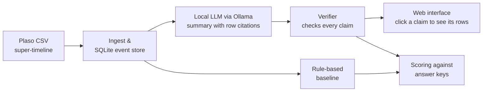

# Evidence-Grounded Forensic Timeline Reconstruction with Locally Hosted LLMs

**Do they miss or invent evidence?**

COMP3000 Computing Project · BSc Computer Science (Cyber Security)
**Student:** Will Cross · **Supervisor:** Prof Nathan Clarke

> **Status:** Project initiation complete (November 2026). Development starts in Sprint 1. The code, setup instructions and results will be added here as each work package is finished.

---

## Overview

A single Windows computer can produce hundreds of thousands of timeline events. Forensic examiners usually need only the few that answer their question. Large language models (LLMs) could do a first pass over the timeline, but two problems stop them being used on real evidence:

1. **Confidentiality:** cloud models such as ChatGPT require the evidence to be sent to a third party.
2. **Hallucination:** a model may describe events that never happened. In a forensic report, an unsupported claim is worse than no claim.

This project builds an **Evidence-Grounded Timeline Assistant**. It runs entirely on the examiner's own machine, and every statement it makes must cite the timeline rows it is based on. A separate verifier then checks each citation automatically, so the examiner can see straight away which parts of the account are supported.

## Research question

> How often do locally hosted LLMs, at different model sizes and quantisation levels, **find, miss, mis-cite or invent** evidence when reconstructing a forensic timeline?

The results will be compared with:
- a **rule-based baseline** that uses no AI, and
- the published **ChatGPT** results from Studiawan, Breitinger and Scanlon (2025).

## How it works

Each claim the model makes is sorted into one of these categories:

| Result | Meaning |
|---|---|
| **Supported** | The cited row exists and shows what the claim says |
| **Wrong reference** | The event is real, but the claim cites the wrong row |
| **Wrong detail** | The cited row exists, but the claim misdescribes it |
| **Invented** | No row in the timeline supports the claim |

Missed evidence (relevant rows the model never mentions) is measured as well. For an investigator, missing evidence that points away from a suspect can do as much harm as inventing evidence.

## Repository contents

| Path | Contents |
|---|---|
| `PID/COMP3000-PID.docx` | Project Initiation Document: vision, literature review, risks, LSEP and work plan |
| `PID/COMP3000-Risk-Plan.docx` | Risk plan and register |
| `PID/COMP3000-Risk-Matrix.xlsx` | Likelihood × impact risk matrix |
| `PID/COMP3000-Gantt-Chart.xlsx` | Gantt chart for the work plan |

Source code, tests and experiment results will be added in later sprints.

## Work plan

The project runs in two-week Agile sprints from 9 November 2026, with the backlog tracked in GitHub Issues.

| WP | Work package | Sprint(s) | Deliverable |
|---|---|---|---|
| WP0 | Project initiation | 0 | PID; frozen model list |
| WP1 | Ingest and event store | 1 | Tested ingest module |
| WP2 | Local LLM layer | 2 | Tested LLM module |
| WP3 | Verifier and scoring | 3–4 | Verifier with measured accuracy |
| WP4 | Baseline and experiment harness | 5 | Must-have pipeline complete |
| WP5 | Main experiments | 6–7 | Results dataset and analysis |
| WP6 | Web interface | 8 | Working UI |
| WP7 | Improvements and own scenario | 9–10 | Extended results; poster draft |
| WP8 | Testing and code freeze | 11 | Frozen code; poster printed |
| WP9 | Write-up and submission | 12–13 | Report, video and ePortfolio |

**Key milestones:** must-have pipeline (17 Jan 2027) · poster draft (8 Mar) · code freeze (11 Apr) · submission (4 May) · showcase (6 May) · viva (w/c 10 May)

## Data and ethics

- **No real personal data is used.** The main benchmark is the public synthetic Windows 11 dataset from Studiawan, Breitinger and Scanlon (2025), released under the MIT licence.
- A second test scenario will be created on a virtual machine using fictional accounts only. It acts as a clean test set that no model can have seen during training.
- There are no human participants.
- All models run locally, so no timeline data is sent to a third-party service.
- Every run records the model version, prompt and settings so it can be repeated.
- Use of generative AI in this project is logged and declared under the COMP3000 guidance.

## Key references

- Studiawan, H., Breitinger, F. and Scanlon, M. (2025) 'Towards a standardized methodology and dataset for evaluating LLM-based digital forensic timeline analysis', *Forensic Science International: Digital Investigation* (DFRWS APAC 2025).
- Min, S. et al. (2023) 'FActScore: fine-grained atomic evaluation of factual precision in long form text generation', *EMNLP 2023*.
- Hargreaves, C. and Patterson, J. (2012) 'An automated timeline reconstruction approach for digital forensic investigations', *Digital Investigation*, 9, pp. S69–S79.

The full reference list is in the PID.
